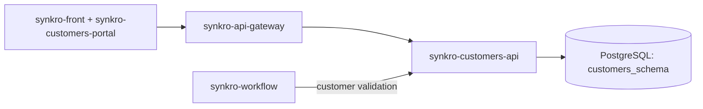

# synkro-customers-api

> Customers service for registration, lookup, contact updates, deactivation, reactivation and bounded name-or-document search.

Part of the **SynkroTech SAS Sales Management System**. Architecture, decisions and
contracts live in [synkro-docs](https://github.com/code-corhuila/synkro-docs).

**Quick start:** configure the Customers schema, restricted credentials and Auth public key; install the Maven modules and run `mvn -pl customers-app spring-boot:run` from this root. See [Getting started](#getting-started).

## What it does

- Registers customers idempotently with a document unique across active and inactive records.
- Lists, searches, reads and updates customer contact information.
- Logically deactivates customers; ADMIN can reactivate with audit attribution.
- Validates JWTs locally and accesses only customers_schema through customers_app.
- Uses JDBC adapters and application ports; infrastructure owns database lifecycle.

## Where it fits



The Angular portal consumes the Host's transport; Workflow reads the customer's published API. Customer identity, data and migration ownership stay within Customers.

## Tech stack

| Component | Choice |
|---|---|
| Language / framework | Java 21; Spring Boot 3.5.0 |
| Build | Maven: customers-core, customers-adapters, customers-app |
| Persistence | JDBC on PostgreSQL 16; no JPA/Hibernate |
| Runtime | Docker service; internal HTTP 8080 |

## Dependencies

| Depends on | Purpose | Configuration |
|---|---|---|
| synkro-customers-db | Schema and permissions | Apply owning migrations first |
| PostgreSQL | Customer and idempotency/audit persistence | Restricted SPRING_DATASOURCE_* |
| Auth public key | Local verification | JWT_PUBLIC_KEY_FILE or JWT_PUBLIC_KEY |
| synkro-api-gateway | Public entry point | platform network |

## Getting started

Use **PowerShell or Bash** from this root with Java 21, Maven, a migrated Customers database and the configuration below supplied to the process:

```text
mvn install -DskipTests
mvn -pl customers-app spring-boot:run
```

The local connection must use customers_app and customers_schema. Docker-only database DNS is not a host-process address.

For the complete platform, start from [synkro-infra-postgres](https://github.com/code-corhuila/synkro-infra-postgres).

## Configuration

The committed [.env.example](.env.example) is the configuration inventory.
Its values are examples; required inputs and defaults follow its comments and the
owning implementation. Keep real secrets in protected local files.

| Variable | Purpose |
|---|---|
| `SERVER_PORT` | Server port |
| `SPRING_DATASOURCE_URL` | Connection address, origin or build-time entry point |
| `SPRING_DATASOURCE_USERNAME` | Connection or administrator identity |
| `SPRING_DATASOURCE_PASSWORD` | Credential supplied locally |
| `SPRING_DATASOURCE_PASSWORD_FILE` | Protected credential file path |
| `JWT_PUBLIC_KEY` | Identity key input; keep private material outside Git |
| `JWT_PUBLIC_KEY_FILE` | Identity key input; keep private material outside Git |
| `CUSTOMERS_APP_PASSWORD_FILE` | Protected credential file path |
| `JWT_PUBLIC_KEY_HOST_FILE` | Identity key input; keep private material outside Git |
| `PLATFORM_NETWORK` | Docker network selection |

## Interface

| Method / route | Access / behavior |
|---|---|
| POST /api/v1/customers | ADMIN or SALESPERSON; Idempotency-Key required |
| GET /api/v1/customers; GET /{id} | ADMIN or SALESPERSON; Workflow can validate by id with customers:read |
| PUT /api/v1/customers/{id} | Contact/name replacement under the published validation rules |
| DELETE /api/v1/customers/{id} | Logical deactivation |
| POST /api/v1/customers/search | Bounded active/inactive search; query in JSON body |
| POST /api/v1/customers/{id}/activate | ADMIN; idempotent audited reactivation |
| GET /health | Public; service and store readiness |

INVENTORY has no Customers access. See the [Customers contract](https://github.com/code-corhuila/synkro-docs/blob/main/07-api/contracts/openapi/synkro-customers-api.yaml).

## Project structure

```text
customers-core/       domain, application use cases and ports
customers-adapters/   HTTP/security and JDBC
customers-app/        Spring composition
deploy/               Docker service, public-key and credential inputs
tests/                owned real-engine and contract verification
docs/                 design, operations and acceptance evidence
```

## Testing

With **Node 22 and Docker**, from this root:

```text
node tests/verify.mjs
node tests/check-deployment.mjs
```

The verifier provisions its own real PostgreSQL fixture and applies coverage/architecture checks. `CUSTOMERS_VERIFY_PACT=1 node tests/verify.mjs` additionally verifies the committed consumer contracts; that assignment uses Bash syntax. Its provenance and incompatible-provider controls are retained in the detailed guide.

## Branching and contributing

Use a `feat/`, `fix/` or `chore/` child branch and a PR into `develop`.
Permanent branches are `develop`, `qa` and `main`; none accepts direct commits.
Promote through a `qa-<description>` or release child with `git cherry-pick -x`.
`main` requires approval from `ariel5253`. Use English Conventional Commits.
See [Git conventions](https://github.com/code-corhuila/synkro-docs/blob/main/00-governance/git-conventions.md).

## Further documentation

- [Local development](docs/local-development.md).
- [Testing](docs/testing.md).
- [Http and authorization](docs/http-and-authorization.md).
- [Deployment](docs/deployment.md).
- [Acceptance and handoff](docs/acceptance-and-handoff.md).
- [Domain rules](https://github.com/code-corhuila/synkro-docs/blob/main/02-domain/entities-and-rules.md), [contracts](https://github.com/code-corhuila/synkro-docs/tree/main/07-api/contracts/openapi) and [testing strategy](https://github.com/code-corhuila/synkro-docs/blob/main/11-quality/testing-strategy.md).

<!-- Preserve previously published README section links. -->
<a id="branching"></a>
<a id="running-locally"></a>
<a id="running-the-tests"></a>
<a id="http-and-authorization"></a>
<a id="deployment-and-operations"></a>
<a id="joint-acceptance-and-handoff"></a>
<a id="consumer-driven-qa-contracts"></a>
<a id="consumer-driven-qa-contracts-1"></a>
